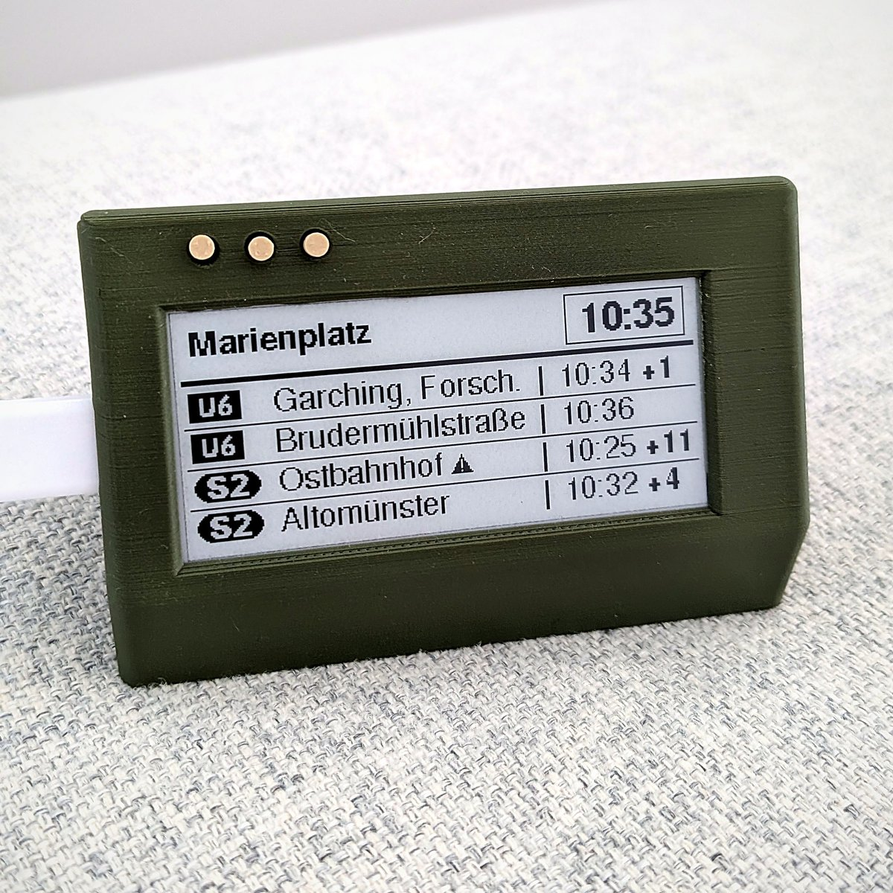
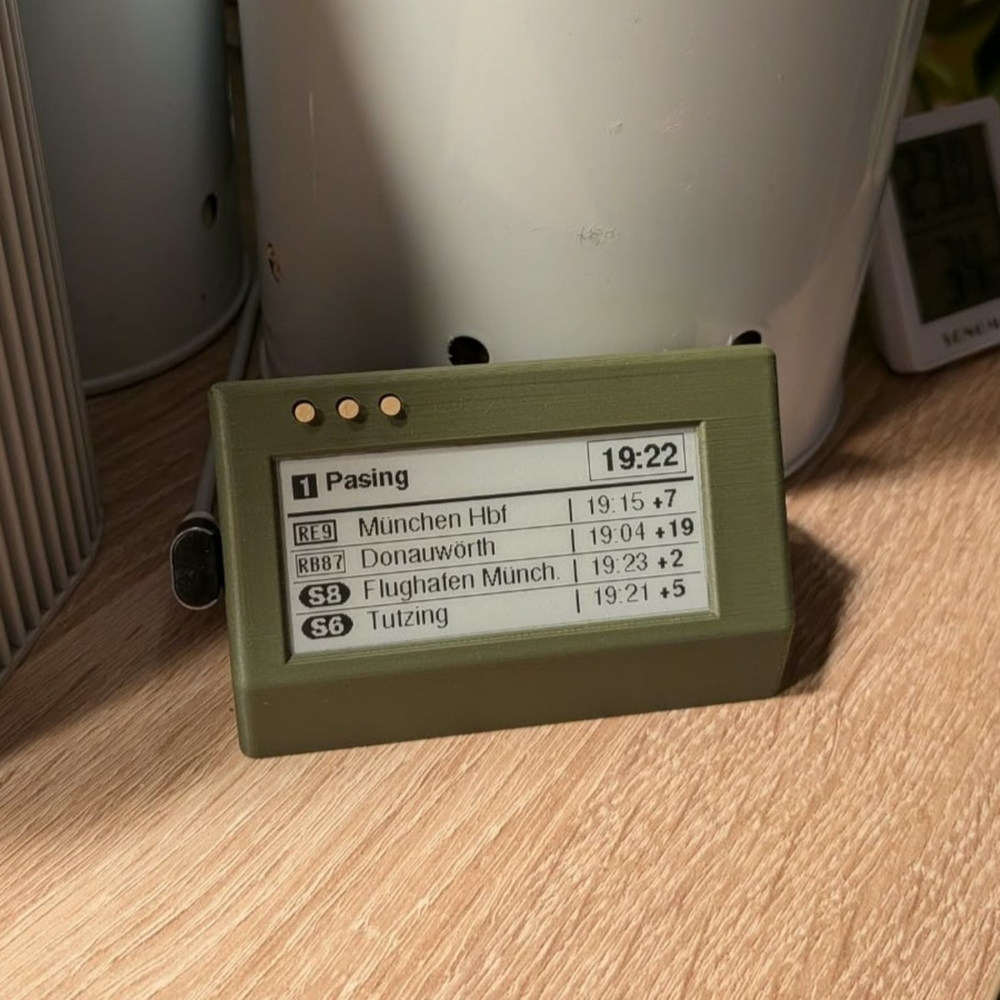
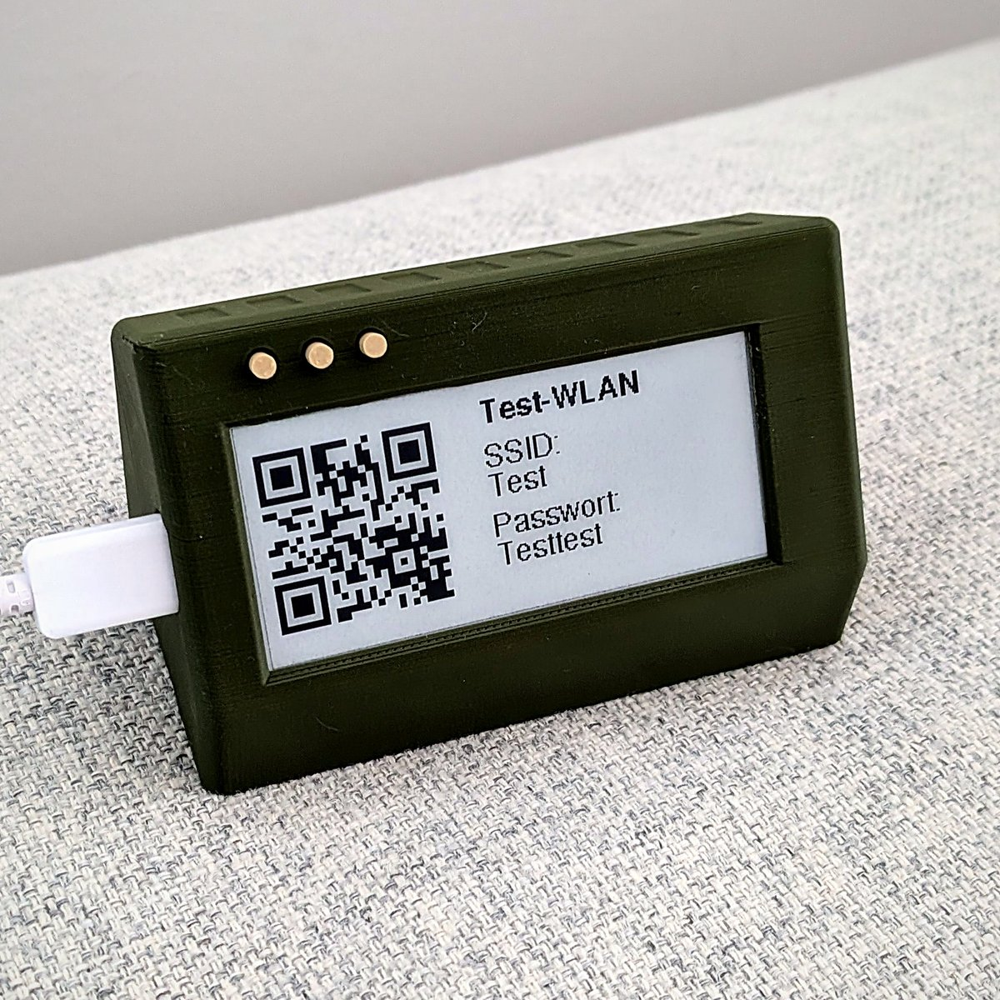
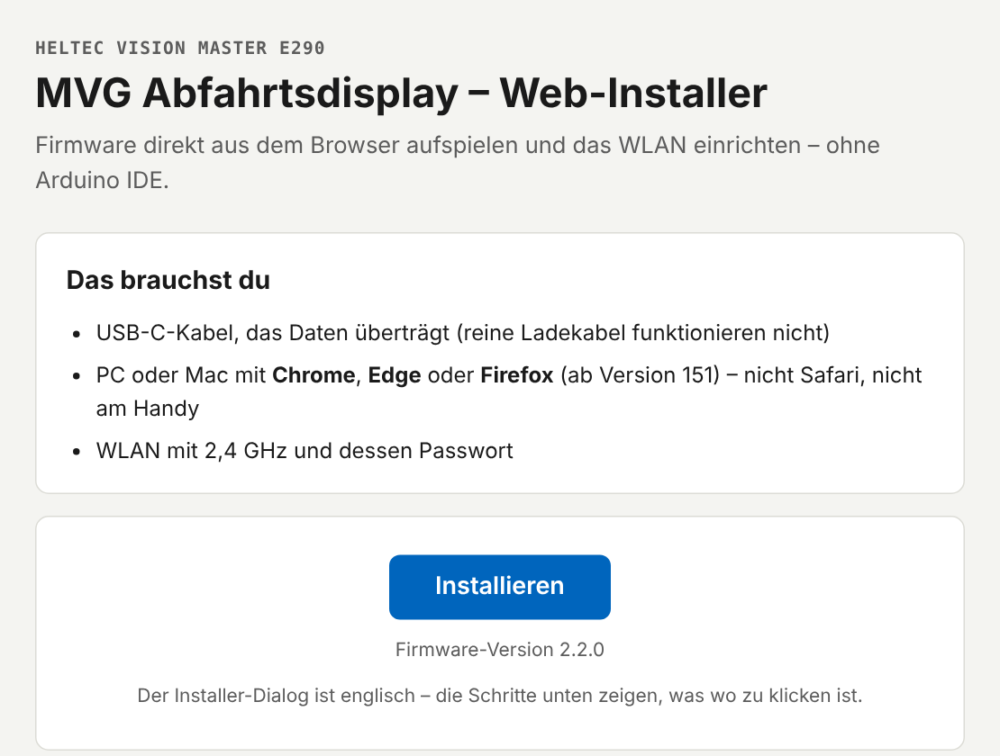
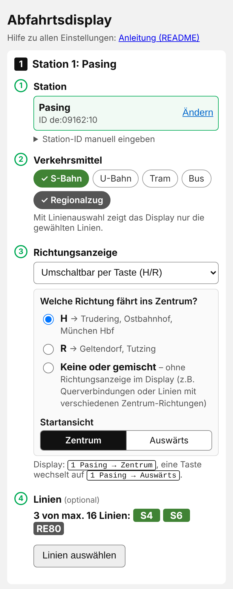
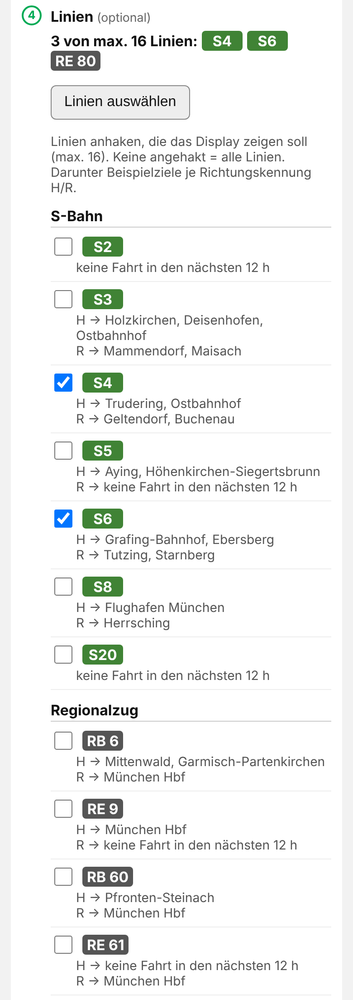
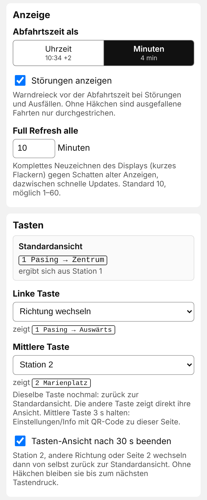

# MVG-Abfahrtsdisplay (Heltec Vision Master E290)

**Deutsch** | [English](README_EN.md)

  
  
  

Ein kleines E-Ink-Display für zu Hause, das die nächsten Abfahrten an deiner
Münchner Haltestelle zeigt – live, mit Verspätungen, Ausfällen und
Störungshinweisen. Auf Wunsch nur bestimmte Linien und Richtungen, und mit
einer zweiten Haltestelle, die eine Taste zeigt. Es läuft
dauerhaft am USB-Netzteil und aktualisiert sich jede Minute.

**Einrichten geht komplett im Browser**, ohne Programmierkenntnisse:
Firmware über den
**[Web-Installer](https://fluddel94.github.io/MVG_Abfahrtsdisplay_E290/)**
aufspielen, WLAN eingeben, Haltestelle auswählen – fertig.

> **Hinweis:** Die Abfahrten stammen aus der **inoffiziellen, nicht
> dokumentierten Schnittstelle der MVG**. Das Projekt steht in keiner
> Verbindung zur MVG, zum MVV oder zur Deutschen Bahn. Laut Impressum der
> MVG wird eine *gemäßigte Nutzung für private, nicht-kommerzielle Zwecke*
> ohne ausdrückliche Zustimmung geduldet. Die Schnittstelle kann sich
> jederzeit ändern oder abgeschaltet werden. Gedacht ist das Display nur für
> das MVG-/MVV-Gebiet.

Wer selbst kompilieren oder den Code ändern möchte: **[README_TECHNIK.md](README_TECHNIK.md)**
(englisch: [README_TECHNIK_EN.md](README_TECHNIK_EN.md)).
Änderungen je Version: [CHANGELOG.md](CHANGELOG.md).

---

## Was das Display kann

- **Die nächsten 4 Abfahrten** mit Linie, Ziel, Uhrzeit und Verspätung
  (z.B. `+3`). Pünktliche Abfahrten zeigen nur die Uhrzeit. Wahlweise
  Minuten bis zur Abfahrt (**4** min, **jetzt**), Verspätung eingerechnet.
- **Richtungen:** alle gemischt, umschaltbar zwischen „Zentrum“ und
  „Auswärts“ (per Taste), nur eine Richtung oder je Linie festgelegt. Im
  Kopf steht dann z.B. „Pasing → Zentrum“.
- **Verkehrsmittel auswählbar:** S-Bahn, U-Bahn, Tram, Bus, Regionalzug.
- **Linienauswahl:** nur die Linien, die dich interessieren – je Linie
  beide Richtungen oder nur eine (bis zu 16 Linien je Haltestelle).
- **Zweite Haltestelle:** z.B. Bus vor der Tür und S-Bahn um die Ecke. Eine
  Taste zeigt sie, nach 30 s geht es zurück zur ersten (abschaltbar).
- **Zwei Tasten frei belegbar:** Richtung wechseln, zweite Haltestelle,
  weitere Abfahrten (Seite 2) oder Gäste-WLAN-QR-Code.
- **Liniensymbole** wie an der Haltestelle.
- **Ausfälle und Störungen:** Fällt ein Zug aus, ist die Uhrzeit
  durchgestrichen; bei Störungen erscheint ein Warndreieck. Endet ein Zug
  früher, steht das tatsächliche Ziel da.
- **Geteilte Züge** (z.B. S1 Flughafen / Freising) erscheinen als eine Zeile –
  auch Regionalzüge, deren Zugteile verschiedene Liniennummern haben (z.B.
  BRB RB 55/56/57, Symbol „RB“, Ziele gekürzt: „Lenggri./Tegerns.“).
- **Ersatzverkehr:** Ersatzbusse für Züge, S-Bahn oder Tram erscheinen als „SEV“.
- **Kurze Störungen bleiben unsichtbar:** Fällt die MVG-Schnittstelle oder
  das WLAN kurz aus, bleiben die Abfahrten bis zu einer Minute stehen
  (die Tasten funktionieren weiter), erst dann erscheint ein Hinweis.
- **Alles im Browser einstellbar** – auch vom Handy aus, über das
  [Einstellungsportal](#einstellungsportal).
- **Updates ohne Datenverlust:** Haltestelle, WLAN und Einstellungen bleiben
  erhalten.
- **Optional:** QR-Code für dein Gäste-WLAN auf Knopfdruck.

## Das brauchst du

- **Heltec Vision Master E290** (Board mit eingebautem 2,9"-E-Ink-Display)
- **USB-C-Kabel, das Daten überträgt** – reine Ladekabel funktionieren nicht
- **USB-Netzteil** für den Dauerbetrieb
- **PC oder Mac** mit **Chrome**, **Edge** oder **Firefox ab Version 151**
  (Safari und Handys gehen für die Einrichtung nicht)
- **WLAN mit 2,4 GHz** (5 GHz allein reicht nicht)
- optional: 3D-Drucker für das [Gehäuse](#gehäuse)

## Einrichtung

Öffne den **[Web-Installer](https://fluddel94.github.io/MVG_Abfahrtsdisplay_E290/)**.
Sein Dialog ist englisch – die Knöpfe stehen deshalb unten *kursiv* im
Original.

  

1. Display per USB an den PC anstecken, auf **Installieren** klicken.
   Firefox fragt vorher, ob die Seite auf serielle Geräte zugreifen darf –
   erlauben.
2. Im Browser-Fenster das Display auswählen (heißt meist *USB JTAG/serial
   debug unit*) und *Connect* klicken.
3. *Install MVG Abfahrtsdisplay* wählen, **Erase device anhaken** und
   bestätigen. Dabei wird die von Heltec
   vorinstallierte Software gelöscht. Das Aufspielen dauert etwa eine Minute.
4. *Connect to Wi-Fi*: dein WLAN wählen und das Passwort eingeben.
5. *Visit device* öffnet die Einstellungen des Displays im Browser.
   (Das Display zeigt dazu auch einen QR-Code – damit geht es vom Handy aus.)
6. Haltestelle suchen, auswählen und **Speichern**. Das Display zeigt sofort
   die Abfahrten.
7. USB-Kabel vom PC abziehen, Display ins Gehäuse und ans Netzteil – fertig.

Klappt etwas nicht? Siehe [Hilfe bei Problemen](#hilfe-bei-problemen).

## Bedienung

Über dem Display sitzen drei Tasten nebeneinander. Von vorne gesehen:
**links** (auf dem Board „BOOT“), **Mitte** (auf dem Board „21“),
**rechts** (auf dem Board „RST“ – startet das Display neu).

Linke und mittlere Taste haben je **eine** Funktion, die du im Portal
unter *Tasten* festlegst:

| Belegung | Was die Taste zeigt |
|---|---|
| **Richtung wechseln** | die andere Richtung (nur bei „Umschaltbar per Taste“) |
| **Station 2** | die zweite Haltestelle |
| **Weitere Abfahrten (Seite 2)** | Abfahrt 5–8 |
| **WLAN-QR-Code** (nur Mitte) | QR-Code fürs Gäste-WLAN für 60 s |
| **Keine Funktion** | – |

Ein Druck zeigt die Ansicht der Taste. Dieselbe Taste nochmal – oder
30 Sekunden Warten – führt zurück zur **Standardansicht** (Station 1 mit
ihrer Startrichtung). Die andere Taste zeigt direkt ihre Ansicht. Ohne
das Häkchen „Tasten-Ansicht nach 30 s beenden“ (Portal, Bereich „Tasten“)
bleibt die Ansicht stehen, bis du eine Taste drückst.

| Taste | Was passiert |
|---|---|
| **Mittlere Taste** 3 Sekunden halten | System-Info für 60 s – und das [Einstellungsportal](#einstellungsportal) öffnet sich für 30 Minuten. Nochmal 3 s halten = zurück. |
| **Rechte Taste** | Neustart |

## Einstellungsportal

Das Display hat eine eigene kleine Webseite. Dort stellst du alles ein –
vom PC oder Handy, solange es im selben WLAN ist. Änderungen gelten sofort
nach dem Speichern.

**So öffnest du es:** die mittlere Taste drei Sekunden halten. Das Display zeigt
dann die Adresse (z.B. `http://192.168.178.42`) – diese im Browser eintippen.
Das Portal bleibt 30 Minuten offen. Bei der ersten Einrichtung führt
*Visit device* im Web-Installer direkt hin.

Jede Station stellst du in vier Schritten ein; unter jeder Einstellung
steht, was das Display danach zeigt. *Speichern* sitzt in der Leiste am
unteren Rand – sie zeigt auch, ob es ungespeicherte Änderungen gibt.
Fehlt etwas, ist die Stelle rot markiert.

  
  
  

**Was du einstellen kannst:**

1. **Station:** Namen eintippen und *Suchen*. Bei gleichnamigen
   Haltestellen hilft der Link zur Karte. Mit *Auswählen* übernehmen –
   die Station erscheint als Karte, *Ändern* sucht eine andere. Die
   Station-ID lässt sich unter *Station-ID manuell eingeben* auch von
   Hand eintragen.
2. **Verkehrsmittel:** S-Bahn, U-Bahn, Tram, Bus, Regionalzug.
   Gestrichelt = fährt an dieser Station nicht.
3. **Richtungsanzeige:**
   - *Alle Richtungen gemischt*
   - *Umschaltbar per Taste (H/R)* – eine Taste wechselt zwischen den
     beiden Richtungen (nur Station 1); dazu die *Startansicht*
   - *Nur Richtung H* bzw. *Nur Richtung R*
   - *Je Linie wählen* – die Richtung legst du dann je Linie in der
     Linienauswahl fest

   *H* und *R* sind die Richtungskennungen der MVG; das Portal zeigt dazu
   Beispielziele. Bei *Umschaltbar* und *Nur H/R* fragt es, **welche
   Richtung ins Zentrum fährt** – dann steht im Kopf „→ Zentrum“ bzw.
   „→ Auswärts“. Bei Querverbindungen oder wenn die Linien der Station
   unterschiedlich ins Zentrum fahren, *Keine oder gemischt* wählen: Bei
   *Nur H/R* steht dann nur der Stationsname da, bei *Umschaltbar*
   „→ H“/„→ R“.
4. **Linien (optional):** *Linien auswählen* listet alle Linien der
   angehakten Verkehrsmittel mit Beispielzielen je Richtung (das Laden
   dauert etwa 10 Sekunden). Bis zu 16 Linien anhaken; ohne Häkchen zeigt
   das Display alle Linien der gewählten Verkehrsmittel. *Fertig* klappt
   die Liste zu.

Außerdem:

- **Station 2 (optional):** *Zweite Station hinzufügen* – mit eigenen
  Verkehrsmitteln, eigener Richtung und eigenen Linien, gleiche Schritte
  wie oben. Im Kopf steht dann die Nummer der Station. Sie wird
  automatisch einer freien Taste zugeordnet.
- **Anzeige:** Abfahrtszeit als *Uhrzeit* (10:34 +2) oder *Minuten*
  (**4** min).
- **Tasten:** zeigt die Standardansicht und die Belegung der linken und
  mittleren Taste (siehe [Bedienung](#bedienung)). Ist eine Funktion
  keiner Taste zugeordnet, erscheint ein Hinweis. Häkchen „Tasten-Ansicht
  nach 30 s beenden“ (Standard: an).
- **WLAN-QR-Code** (bei Belegung der mittleren Taste): Überschrift, Name
  und Passwort des WLANs, das Gäste per QR-Code bekommen sollen. Das
  Passwort steht dann gut lesbar auf dem Display – nimm also nur ein
  WLAN, das du teilen möchtest.
- **Firmware aktualisieren:** siehe [Update](#update).
- **Werkseinstellungen:** löscht alle Einstellungen inklusive WLAN.

Das Portal hat kein eigenes Passwort. Während es offen ist, kann jeder in
deinem WLAN die Einstellungen ändern – deshalb schließt es sich nach
30 Minuten von selbst.

## Update

Haltestelle, WLAN und Einstellungen bleiben bei beiden Wegen erhalten.

- **Mit Kabel:** Web-Installer öffnen, **Installieren**, Display wählen,
  *Update MVG Abfahrtsdisplay*.
  Fragt der Installer nach *Erase device*: Häkchen **weglassen**, sonst sind
  WLAN und Haltestelle weg.
- **Ohne Kabel:** Datei `firmware.bin` aus dem
  [aktuellen Release](https://github.com/Fluddel94/MVG_Abfahrtsdisplay_E290/releases/latest)
  herunterladen, im Portal unter *Firmware aktualisieren* auswählen und
  *Hochladen*. Das Display startet danach neu.

## WLAN ändern

Display per USB an den PC, Web-Installer öffnen, **Installieren**, Display
wählen, *Change Wi-Fi*. Klappt die Verbindung nicht, bleibt das bisherige
WLAN gespeichert.

## Hilfe bei Problemen

### Das Display taucht im Browser-Fenster nicht auf
Ein anderes USB-Kabel (es muss Daten übertragen) oder einen anderen
USB-Anschluss probieren.

### Der PC piept im Sekundentakt
Auf dem Display ist keine Software (z.B. nach einer abgebrochenen
Installation), es startet ständig neu. Dann hilft die Notlösung.

### Notlösung
Kabel abziehen. Die **linke Taste** (BOOT) gedrückt halten und dabei das Kabel
einstecken, nach zwei Sekunden loslassen. Dann im Web-Installer
**Installieren**.
**Wichtig:** Nach dem Aufspielen startet das Display erst, wenn du das
Kabel einmal ab- und wieder ansteckst – bis dahin tut sich auf dem
Bildschirm nichts. Danach **Installieren** → *Connect to Wi-Fi*.

### Nach der Installation fehlt *Connect to Wi-Fi*
Kabel ab- und wieder anstecken, etwa zehn Sekunden warten (das Display
zeigt „Keine WLAN-Daten“), dann erneut **Installieren**.

### Mein WLAN fehlt in der Liste
Dialog schließen und *Connect to Wi-Fi* nochmal öffnen – oder unten
*Join other…* wählen und den WLAN-Namen selbst eintippen. Das Display kann
nur 2,4-GHz-WLAN.

### Das Display zeigt „Keine WLAN-Daten“
Es ist noch kein WLAN gespeichert (z.B. nach den Werkseinstellungen): per
USB im Web-Installer *Connect to Wi-Fi*.

### Das Display zeigt einen WLAN-Fehler
Er erscheint, wenn das WLAN länger als eine Minute weg ist (beim Start nach
20 Sekunden). Das Display nennt die vermutete Ursache (z.B. „Passwort
falsch?“) und versucht es selbst erneut – zuerst nach wenigen Sekunden,
dann alle 30 Sekunden. Stimmt das Passwort nicht: im Web-Installer
*Change Wi-Fi*.

### Das Display verliert immer wieder das WLAN
Der kleine Funkchip des Displays empfängt deutlich schlechter als Laptop
oder Handy und kann nur 2,4 GHz. Hilft oft: das Display anders hinstellen
oder näher an den Router, ein ordentliches USB-Netzteil statt des
PC-Anschlusses. Die Signalstärke steht im Portal unter *Gerät* (schlechter
als etwa -75 dBm ist knapp).

### Das Display zeigt einen Fehler beim Abruf
Die MVG-Schnittstelle antwortet seit über einer Minute nicht (z.B.
Wartung). Das Display versucht es alle 10 Sekunden erneut und zeigt die
Abfahrten von selbst wieder, sobald es klappt.

### Das Portal lässt sich nicht öffnen
Es ist nur 30 Minuten nach dem Öffnen erreichbar: die mittlere Taste
drei Sekunden halten und die angezeigte Adresse verwenden. PC oder Handy müssen
im selben WLAN sein.

## Gut zu wissen

- Ohne Linienauswahl erscheinen an großen Stationen alle Linien der
  gewählten Verkehrsmittel gemischt.
- Selten fahrende Linien an großen Stationen: Die Vorschau reicht etwa
  90 Minuten. Fährt eine gewählte Linie seltener, bleiben Zeilen leer.
- Ersatzbusse für Regionalzüge erscheinen, sobald irgendein Regionalzug
  gewählt ist – die MVG nennt dabei nur die Zugnummer, nicht die Linie.
- Seite 2 (Abfahrt 5–8) gibt es für Station 1, Station 2 zeigt vier
  Abfahrten.
- In der Minuten-Anzeige stehen Abfahrten ab 60 Minuten mit Uhrzeit.
- Außerhalb Münchens nennt die MVG Haltestellen oft ohne Ort (z.B. „Stadt
  Busbahnhof“ statt „Wasserburg Stadt Busbahnhof“).
- Pünktliche Abfahrten sehen genauso aus wie Abfahrten ohne Live-Daten.
- Ersatzbusse (SEV) erscheinen beim ersetzten Verkehrsmittel – der Ersatzbus
  für die S2 also auch, wenn nur „S-Bahn“ eingeschaltet ist. Live-Daten
  haben sie meist nicht.
- Lange Stationsnamen werden im Kopf gekürzt („.“ am Ende).

Mehr Details: [README_TECHNIK.md](README_TECHNIK.md#einschränkungen-im-detail).

## Gehäuse

Im Ordner [`gehaeuse/`](gehaeuse/) liegt ein Gehäuse zum 3D-Drucken. Es ist
ein Remix von **„Vision Master E290 V0.3.1 case for Meshtastic“** von
**HarukiToreda** ([Printables 974647](https://www.printables.com/model/974647)),
lizenziert unter [CC BY 4.0](https://creativecommons.org/licenses/by/4.0/).
Änderungen: Antennenanschluss entfernt, Schrift- und Logovertiefungen
entfernt, das Gehäuse steht geneigt auf dem Tisch. Der Remix steht ebenfalls unter CC BY 4.0.
Die Druckdateien gibt es auch auf
[MakerWorld](https://makerworld.com/de/models/3385427-heltec-e290-munich-departure-display-mvg-mvv).

## Lizenz

- **Code:** [GNU General Public License v3.0 oder später](LICENSE)
  (GPL-3.0-or-later).
- **Schriften** `src/FreeSans9pt8b.h`, `src/FreeSansBold9pt8b.h`: abgeleitet
  aus den Adafruit-GFX-Schriften bzw. aus
  [GNU FreeFont](https://www.gnu.org/software/freefont/) (GPL-3.0-or-later
  mit Font-Ausnahme).
- **Liniensymbole** S-Bahn/U-Bahn: konvertiert aus SVG-Dateien von
  [Wikimedia Commons](https://commons.wikimedia.org/), dort als gemeinfrei
  gekennzeichnet. Tram-, Nacht-Tram-, Bus- und Zug-Symbole sind eigene
  Pixelgrafiken. Die Liniensymbole können Marken der jeweiligen Inhaber
  (MVV, MVG, DB) sein.
- **Haltestellenliste** `haltestellen/`: Münchner Verkehrs- und
  Tarifverbund GmbH (MVV), CC BY 4.0, Details in
  [`haltestellen/README.md`](haltestellen/README.md).
- **Gehäuse:** CC BY 4.0, siehe [Gehäuse](#gehäuse).
- **Web-Installer:** nutzt [ESP Web Tools](https://github.com/esphome/esp-web-tools)
  (Apache-2.0), geladen von unpkg.com, nicht in diesem Repository enthalten.
- Verwendete Libraries (nicht in diesem Repository enthalten) stehen unter
  ihren eigenen Lizenzen.

Bei der Entwicklung hat uns Claude (Anthropic) mit Agentic Coding unterstützt.

Keine Gewähr für Richtigkeit und Vollständigkeit der angezeigten Daten.
